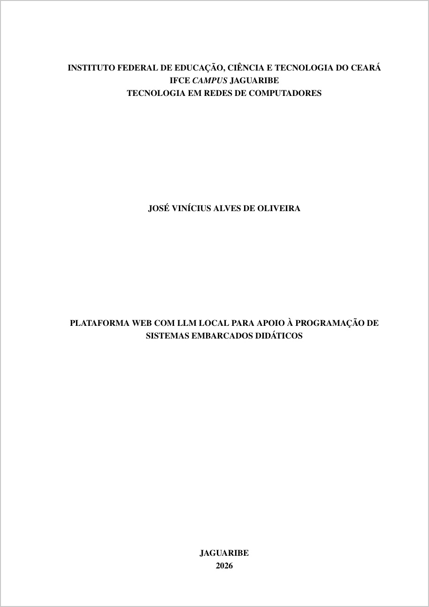
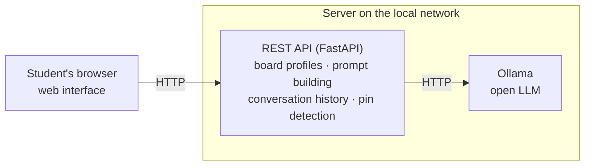
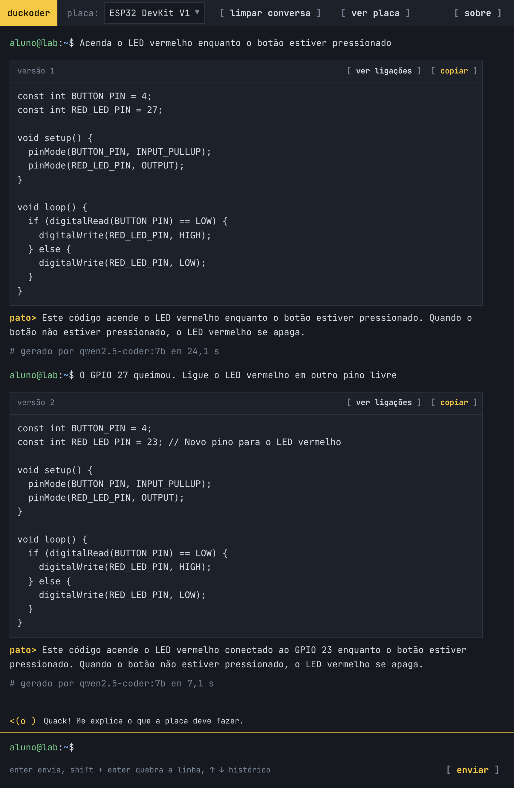
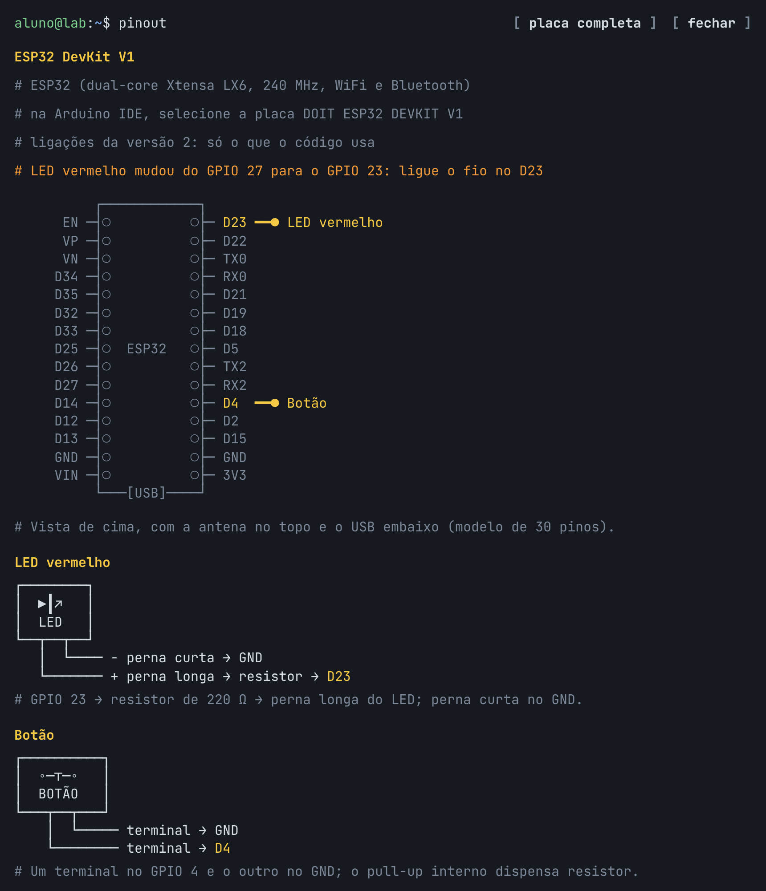

# Duckoder: undergraduate thesis

**Plataforma web com LLM local para apoio à programação de sistemas embarcados didáticos**
(*A web platform with a local LLM to support programming teaching boards for embedded systems*)

Undergraduate thesis (TCC) for the Technology degree in Computer Networks (Tecnologia em Redes de
Computadores) at the Instituto Federal do Ceará (IFCE), Campus Jaguaribe, 2026.

- **Author:** José Vinícius Alves de Oliveira
- **Advisor:** Prof. Dr. Herleson Paiva Pontes

The thesis is written in Portuguese, in LaTeX with [abnTeX2](https://www.abntex.net.br), following
the IFCE academic work template. The platform it describes is in
[ctrl-vini/duckoder](https://github.com/ctrl-vini/duckoder).

## Read the thesis

<p align="center">
  <a href="tcc.pdf"></a>
</p>

<p align="center"><a href="tcc.pdf"><b>Open the full thesis (PDF, in Portuguese)</b></a></p>

## The work

Language models can help students program teaching boards such as the ESP32 or the Arduino Mega
2560, but a general-purpose model does not know how the board in front of them is wired. Earlier work, such as the BitDogLab platform, solves this by sending the board's
hardware description to a commercial cloud model, which the student has to load by hand. That
depends on an internet connection, has a cost per request and sends the class's data outside the
institution.

This work builds **Duckoder**, a web platform that keeps the whole loop on the local network:

- the student picks a board, describes in plain language what it should do and gets back Arduino
  code with a short explanation, which can be refined in the same conversation;
- a REST API inserts the board's hardware profile (components, pins and notes) into every prompt,
  so the student never handles that description;
- an open model runs on a server of the local network through [Ollama](https://ollama.com), with no
  cloud service and no cost per request.

The platform is then evaluated with ten hands-on activities, executed on the real boards, measuring
how many of the generated programs work and how long the model takes to answer.

Out of scope: hardware design, training or fine-tuning models, flashing the board from the
platform, real-time charts and tests with classes of students.

## Architecture



The interface only presents; the API holds the platform's rules; the model is reached through a
small interface, so it can be swapped without touching the rest, which the evaluation uses to
compare two models.

## Interface

<p align="center">
  
  
</p>

On the left, a conversation with the ESP32: the first request and a refinement, each answered with
code and an explanation. On the right, the board panel, which shows how to wire the components used
by each version of the code.

## Evaluation

Ten activities of increasing complexity, split evenly between the two boards. The ESP32 keeps the
ones that depend on its own features (WiFi, its PWM API and I2C on configurable pins).

| Activity | Description | Complexity | Board |
| --- | --- | --- | --- |
| A1 | Blink the built-in LED | Low | Mega 2560 |
| A2 | Fade an LED with PWM | Low | ESP32 |
| A3 | Read a button and drive an LED | Low | Mega 2560 |
| A4 | Play a sequence of tones on a buzzer | Medium | Mega 2560 |
| A5 | Print a temperature sensor's readings on the serial port | Medium | Mega 2560 |
| A6 | Show a sensor's readings on an I2C display | Medium | ESP32 |
| A7 | Light different LEDs by potentiometer range | Medium | Mega 2560 |
| A8 | Join a WiFi network and log the address obtained | High | ESP32 |
| A9 | Serve a sensor's readings on a web page | High | ESP32 |
| A10 | Drive an actuator from HTTP requests | High | ESP32 |

Each activity was sent three times to each of two open models of similar size, both 4-bit
quantized and served by the same Ollama instance: **Qwen2.5-Coder 7B**, trained for code, and
**Llama 3.1 8B**, general purpose. That makes 60 generations. Every program was compiled and run, and its behavior was checked
against the activity; when it failed, the error went back through the same conversation, in up
to two refinement rounds. The server was a Mac mini with an Apple M4 and 16 GB
of memory.

Results:

- **Working code:** Qwen2.5-Coder produced working code in the first answer in 25 of 30
  generations (83%) and in 26 (87%) after refinement; Llama 3.1 in 20 (67%) and 23 (77%). Every
  generation for the low-complexity activities worked in the first answer, and the failures
  concentrated on specific libraries, such as the OLED display and the web servers. Refinement
  recovered 4 of the 8 compilation errors and none of the 7 programs that compiled but behaved
  differently from what was asked.
- **Response time:** 13.9 s on average for Qwen2.5-Coder (3.4 to 27.8 s, about 21 tokens/s) and
  12.3 s for Llama 3.1 (5.6 to 26.5 s, about 19.5 tokens/s). Time grows almost linearly with the
  length of the code.
- **Network:** the exchange between browser, API and model added 4 to 10 ms to each request, and no
  reply was larger than 4.4 kB, against seconds of inference.

## Status

The text is complete. Still to be filled in before the defense: the names of the other two
members of the examination board and the catalog card, generated with the IFCE library tool.

## Repository structure

```text
main.tex              document entry point
config/               packages, IFCE style, custom commands and cover data
pretextual/           abstracts, lists and other elements before the text
chapters/             01 introduction, 02 theoretical background, 03 methodology,
                      04 results, 05 conclusion
postextual/           appendices: board profiles sent to the model and evaluation prompts
figures/              interface screenshots
references.bib        bibliography (BibTeX, abntex2cite)
tcc.pdf               compiled thesis, a copy of build/main.pdf
assets/               cover image shown in this README
CITATION.cff          citation metadata behind GitHub's "Cite this repository" button
tex-fmt.toml          formatter settings used by LaTeX Workshop
```

## Building

Requires a TeX distribution with abnTeX2 and `latexmk`: MacTeX or a full TeX Live already has
both. On Debian or Ubuntu, a minimal TeX Live also needs `texlive-publishers`,
`texlive-lang-portuguese` and `texlive-lang-english`.

```bash
latexmk -pdf -outdir=build main.tex
```

The PDF is written to `build/main.pdf`; `tcc.pdf`, at the root, is a copy of it, updated by
hand after each revision. In VS Code, LaTeX Workshop uses the same recipe and output
folder. The document also compiles on Overleaf with pdfLaTeX.
